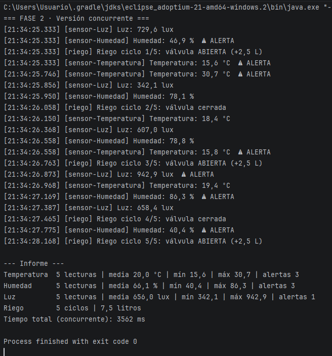

# Invernadero con hilos

Práctica del Tema 4 de Programación de Servicios y Procesos (2.º DAM). Jorge Moreno Rivero.

## Qué hace

Simula un invernadero con tres sensores (temperatura, humedad y luz) y un programador de riego. Cada sensor toma 5 lecturas y avisa con una alerta cuando el valor se sale de su rango. El riego hace 5 ciclos y echa 2,5 litros cada vez que abre la válvula. Al final se imprime un informe con las estadísticas de cada dispositivo.

Lo que quería comprobar es cuánto se gana al pasar de hacerlo todo seguido en `main` a repartirlo en hilos. Hay una clase por fase:

- `Fase1_Secuencial`: todo seguido, llamando a `run()`.
- `Fase2_Concurrente`: un hilo por dispositivo, con `start()` y `join()`.
- `Fase3_Experimentos`: tres pruebas para entender `start()`, `run()` y `join()`.
- `Fase4_Vigilante`: un hilo demonio que enseña el estado de los demás.

Los sensores son `Runnable` (una clase abstracta `Sensor` y tres hijas) y el riego hereda de `Thread`. No he usado `ExecutorService`, ni pools, ni hilos virtuales.

## Cómo ejecutarlo

Abro el proyecto en IntelliJ con JDK 21 y pulso la flecha verde del `main` de la clase que quiera probar. Las cuatro terminan solas.

Por consola, desde la raíz del repositorio:

```
javac -d out src/*.java
java -cp out Fase2_Concurrente
```

Se cambia `Fase2_Concurrente` por la fase que se quiera ejecutar.

## Captura



## Resultados

Medí cada versión tres veces:

| Versión | Medidas (ms) | Media (ms) |
|---|---|---|
| Fase 1 (secuencial) | 11 173 · 11 223 · 11 199 | 11 198 |
| Fase 2 (concurrente) | 3 575 · 3 560 · 3 562 | 3 566 |

Con hilos tarda algo más de tres veces menos (11 198 / 3 566 ≈ 3,1).

## Análisis

### ¿Por qué compensa usar hilos en el invernadero?

Porque casi todo lo que hace el programa es esperar. Cada dispositivo toma un valor y se queda dormido en el `sleep` hasta la siguiente lectura. En la versión secuencial esas esperas van una detrás de otra: 5 × 400 de la temperatura, 5 × 600 de la humedad, 5 × 500 de la luz y 5 × 700 del riego suman 2 000 + 3 000 + 2 500 + 3 500 = 11 000 ms. Me salió una media de 11 198, así que la suma se cumple y sobran unos 200 ms de arrancar y escribir en consola.

Con un hilo por dispositivo las esperas pasan a la vez y el total es lo que tarda el más lento, que es el riego con 3 500 ms. Me salió una media de 3 566. Eso confirma la hipótesis del enunciado: secuencial es la suma y concurrente es más o menos el máximo.

Un matiz: aquí los hilos ganan tanto porque las tareas casi no trabajan, solo esperan. Si cada una hiciera un cálculo pesado, la mejora dependería de cuántos núcleos tenga el ordenador.

También vi que el orden de las primeras líneas del log cambia de una ejecución a otra. Lo decide el planificador del sistema y no mi código, así que no puedo contar con ningún orden. El informe sí sale siempre completo, gracias a los `join()`.

### Experimentos A, B y C (qué pasó y por qué)

**A. Informe sin esperar.** Lancé el sensor de humedad en un hilo y pedí el informe justo después del `start()`. Salió «0 lecturas (todavía sin datos)». `start()` no espera a nadie: deja el hilo listo y `main` sigue con la línea siguiente, que ya era el informe, antes de que el sensor midiera nada. Después del `join()` salieron las 5 lecturas con su media y sus alertas. Por eso en la Fase 2 el informe va siempre después de los `join()`.

**B. `run()` en vez de `start()`.** Con un riego de 3 ciclos llamé a `riego.run()`. En el log salió `[main]` en las tres líneas y no `[riego]`. Tardó 2 132 ms (3 ciclos de 700 ms y un poco de retraso), con `main` parado todo ese tiempo. El estado del objeto al final fue `NEW`. `run()` es un método normal y lo ejecuta quien lo llama. Como nunca llamé a `start()`, el hilo no llegó a arrancar y por eso sigue en `NEW`. Es la misma prueba que hicimos con los cohetes en clase.

**C. `start()` dos veces.** Arranqué un riego, esperé a que terminara con `join()` (estado `TERMINATED`) y volví a llamar a `start()` sobre el mismo objeto. Saltó `java.lang.IllegalThreadStateException`. Quiere decir que ese hilo ya se arrancó una vez y no se puede arrancar otra: cuando termina se queda en `TERMINATED` para siempre. Si quiero repetir el riego tengo que crear un objeto nuevo.

### Estados observados

El vigilante imprimió el estado de los cuatro hilos cada 300 ms. Estos fueron los que vi:

| Estado | Cuándo | Qué línea lo provoca |
|---|---|---|
| `NEW` | Antes de arrancar (línea «main (antes)») | Se hace el `new`, pero todavía no el `start()` |
| `RUNNABLE` | Justo después de `start()`, y algún instante suelto durante la ejecución | `start()` deja el hilo listo; también cuando despierta del `sleep` y vuelve a trabajar |
| `TIMED_WAITING` | Casi todo el tiempo | `Thread.sleep(periodoMs)` dentro del `run()` |
| `TERMINATED` | Según acaba cada hilo: la temperatura primero y el riego el último | Se llega al final del `run()` |

No salieron `WAITING` ni `BLOCKED`. `WAITING` aparece con un `join()` o un `wait()` sin tiempo, y mis hilos solo duermen con `sleep`, que lleva tiempo y por eso es `TIMED_WAITING`. El único `join()` lo hace `main`, y `main` no está en la lista del vigilante. `BLOCKED` solo sale cuando varios hilos pelean por un cerrojo (`synchronized`), y yo no uso ninguno ni comparto datos entre hilos: cada sensor lleva sus propias estadísticas. Además, el vigilante mira cada 300 ms y un estado muy corto se le podría escapar.

**¿Por qué termina el programa si el vigilante sigue en su bucle?** Porque lo marqué como demonio con `setDaemon(true)`, antes del `start()` (después da error). La JVM se cierra cuando solo quedan hilos demonio, y no los espera. Cuando acaban los sensores, el riego y `main`, el vigilante es lo único que queda y la JVM lo corta sin más. Sin `setDaemon(true)` el programa no terminaría nunca.

### Thread frente a Runnable

| Aspecto | `extends Thread` | `implements Runnable` |
|---|---|---|
| Qué representa el objeto | El propio hilo | Una tarea, algo que hay que hacer |
| Cómo se arranca | Directamente con `objeto.start()` | Hay que meterlo en un hilo: `new Thread(tarea).start()` |
| Nombre del hilo | Se pone con `super("nombre")` y se lee con `getName()` | No tiene `getName()`. Se da en `new Thread(tarea, "nombre")` y se lee con `Thread.currentThread().getName()` |
| Herencia | Gasta la única herencia de Java | La clase sigue libre para heredar de otra |
| Reutilización | Un hilo solo se arranca una vez (experimento C) | La misma tarea se puede meter en hilos nuevos |

**¿Por qué los sensores solo pueden ser `Runnable` en mi diseño?** Porque `Temperatura`, `Humedad` y `Luz` ya heredan de `Sensor`, que es donde está todo lo común (lecturas, alertas, estadísticas, espera). Java solo deja heredar de una clase, así que no pueden heredar también de `Thread`. Con `Runnable` no hay problema porque es una interfaz y se puede implementar a la vez.

**¿Qué forma elegiría para el riego?** Creo que `Runnable`. Con `extends Thread` funciona bien en esta práctica porque el riego no hereda de nada, y es cómodo porque ya trae `start()` y `getName()`. Pero me parece más limpio separar lo que hay que hacer del hilo que lo hace: así el riego sería una tarea más, igual que los sensores, se podría reutilizar y no gastaría la herencia.